# Simpliy Slicing – Bedienungsanleitung für Windows

Diese Anleitung beschreibt die frühe Alpha-Version **0.0.0-alpha.1**. Oberfläche und Funktionen können sich in späteren Versionen ändern.

## 1. Installieren und starten

1. Lade das Windows-ZIP von der [Release-Seite](https://github.com/Michaelrossm/Simpliy-Slicing/releases/tag/v0.0.0-alpha.1) herunter und entpacke es vollständig in einen eigenen Ordner.
2. Stelle sicher, dass Microsoft Edge WebView2 Runtime installiert ist.
3. Installiere PrusaSlicer separat. Simpliy wurde mit **PrusaSlicer 3.0.0-alpha14** getestet; die Engine ist nicht im Paket enthalten. Die Originalversion gibt es beim [PrusaSlicer-Projekt](https://github.com/prusa3d/PrusaSlicer/releases).
4. Starte `simpliy-slicing.exe`. Falls die Engine nicht erkannt wird, wähle oben **Prusa-Pfad** und zeige auf die installierte PrusaSlicer-Programmdatei. Hinweise im Programm beachten.

Simpliy verwendet PrusaSlicer im Hintergrund als separaten Prozess. Eine kompatible Engine ist für das Slicing erforderlich.

## 2. Drucker und Material einrichten

Für die vollständige bebilderte Ersteinrichtung siehe die [Schritt-für-Schritt-Anleitung](https://github.com/Michaelrossm/Simpliy-Slicing/tree/main/ersteinrichtung). Sie zeigt Engine, Basisprofil, Druckerverwaltung und die Druckereinstellungen anhand eines Erststarts.

**Drucker und Filament beziehungsweise Material müssen beide ausgewählt sein. Fehlt eine dieser Auswahlen, ist Slicen nicht möglich.** Wähle einen vorhandenen Drucker und ein zum Drucker passendes Materialprofil oder lege eigene Einstellungen an. Kontrolliere insbesondere Druckbettgröße, Bauhöhe, Düsendurchmesser, Firmware- und G-Code-Typ sowie Start- und Endbefehle. Prüfe die Temperatur und den Filamentdurchmesser anhand deines tatsächlichen Druckers und Materials. Die angezeigten Profiloptionen hängen von der installierten Engine und deren Profilen ab.

## 3. Modell importieren und positionieren

1. Klicke auf **Modell importieren** oder **Importieren** und wähle deine Modelldatei.
2. Markiere das Modell in der Liste links. Über die Werkzeugleiste kannst du es verschieben, drehen, skalieren oder auf der Platte ablegen.
3. Prüfe, ob das Modell innerhalb des Druckvolumens liegt und die gewünschte Seite auf dem Druckbett steht. Weitere Modelle lassen sich auf derselben oder auf einer weiteren Platte organisieren.
4. Speichere deinen Arbeitsstand über die Projektfunktion, bevor du größere Änderungen vornimmst.

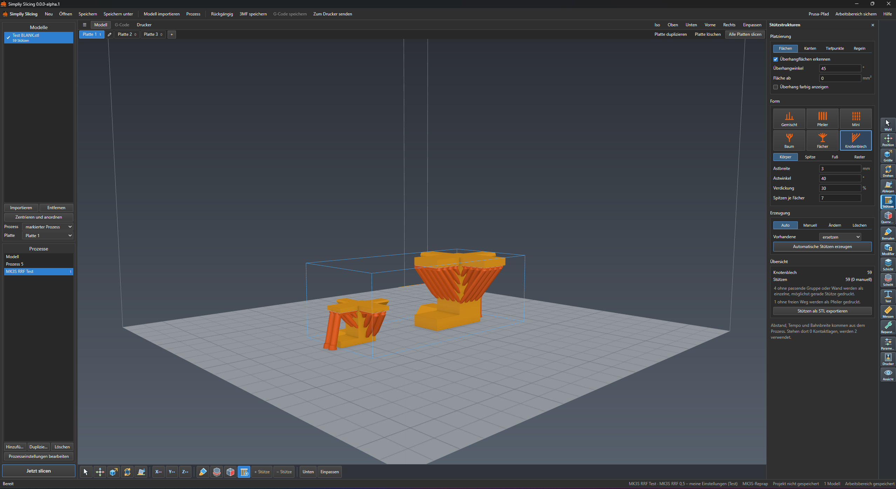

*Modellliste links, Druckplatte in der Mitte und Stützwerkzeug rechts.*

## 4. Prozesse und Einstellungen

Ein Prozess fasst Druckeinstellungen zusammen. Wähle links einen Prozess aus und öffne **Prozesseinstellungen bearbeiten**. Dort findest du Register für Extruder, Schicht, Wände, Füllung, Stützen, Temperatur, Kühlung, Geschwindigkeit, Drucker und Skripte.

Über **Modelle auswählen** kannst du die Zuordnung zum Prozess bearbeiten. Änderungen gelten zunächst für den Prozess; verwende **Prozess speichern**, wenn du eine Konfiguration dauerhaft ablegen möchtest. Benutzerdefinierte Zonen sind in dieser Alpha noch in Entwicklung.

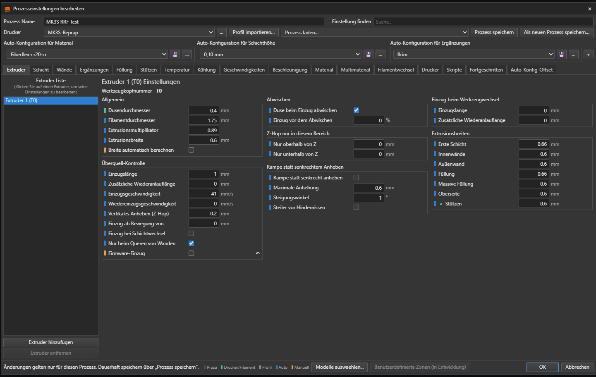

*Prozessdialog mit Extruder- und Einzugseinstellungen.*

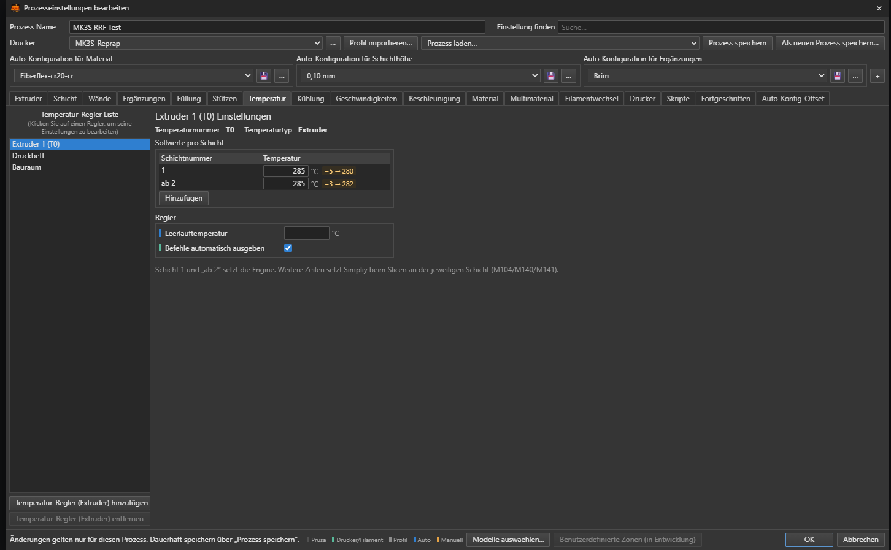

*Temperaturvorgaben für die erste und die folgenden Schichten.*

### Auto-Konfiguration

Mit Auto-Konfigurationen kannst du zusammengehörige Einstellungen beispielsweise für Material oder Schichthöhe wählen. Im Zuweisungsdialog legst du fest, welche Kategorie einen Parameter steuert. Offset-Regeln können Werte abhängig von einer gewählten Option für das Slicing verändern. Überprüfe die angezeigten resultierenden Werte, bevor du slicest.

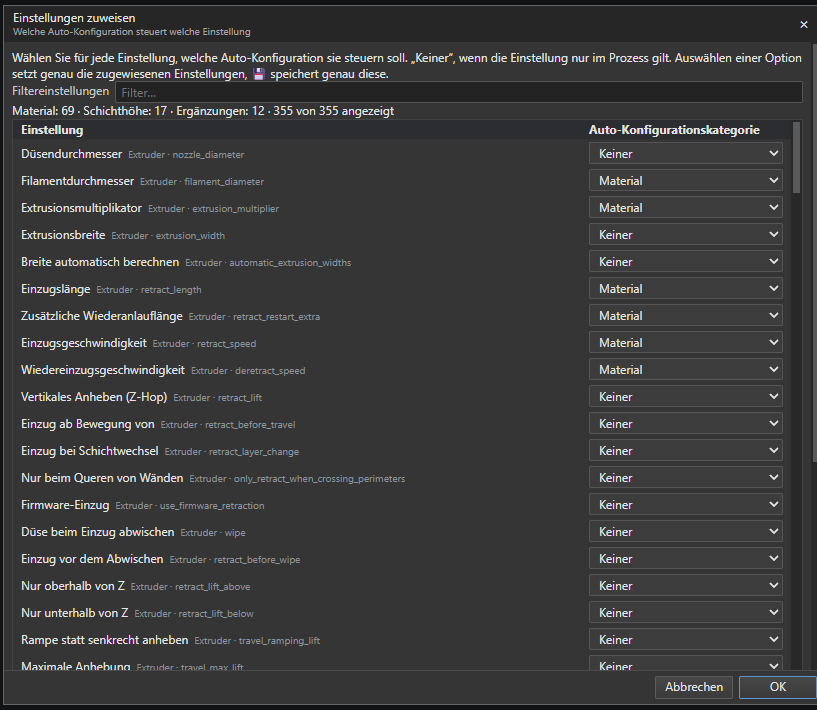

*Hier ordnest du Einstellungen einer Auto-Konfigurationskategorie zu.*

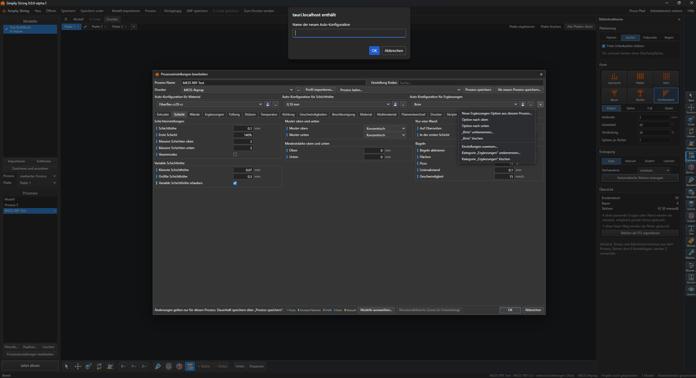

*Im Prozessdialog lassen sich Kategorien und Optionen bearbeiten.*

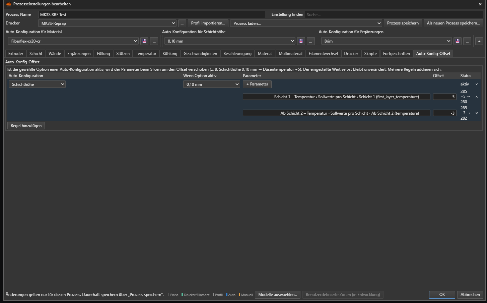

*Offset-Regeln und die daraus resultierenden Werte.*

## 5. Stützen vorbereiten

1. Wähle das Modell und rechts das Werkzeug **Stützen**.
2. Wähle eine Form, zum Beispiel Pfeiler, Baum, Fächer oder Knotenblech. Prüfe die Einstellungen für Platzierung und Geometrie.
3. Erzeuge die Stützen automatisch oder verwende die angebotenen manuellen Werkzeuge. Kontrolliere die Positionen und Kontaktstellen aus mehreren Blickrichtungen.
4. Stelle Abstand und weitere Druckparameter im zugehörigen Prozess ein. Nach Änderungen an Modell oder Ausrichtung die Stützen erneut prüfen und bei Bedarf neu erzeugen.

Die Kombination eigener und automatischer Stützen wird beim Slicing geprüft. Schutzbereiche können die automatische Erzeugung lokal einschränken. Wenn die Prüfung fehlschlägt oder nicht möglich ist, kann Simpliy mit Hinweis auf einen sicheren Rückfall wechseln. Für diese Kombination **Text-G-Code** verwenden. Prüfe auch dann die Kontaktbereiche in der Vorschau; eine Prüfung ersetzt keinen Testdruck.

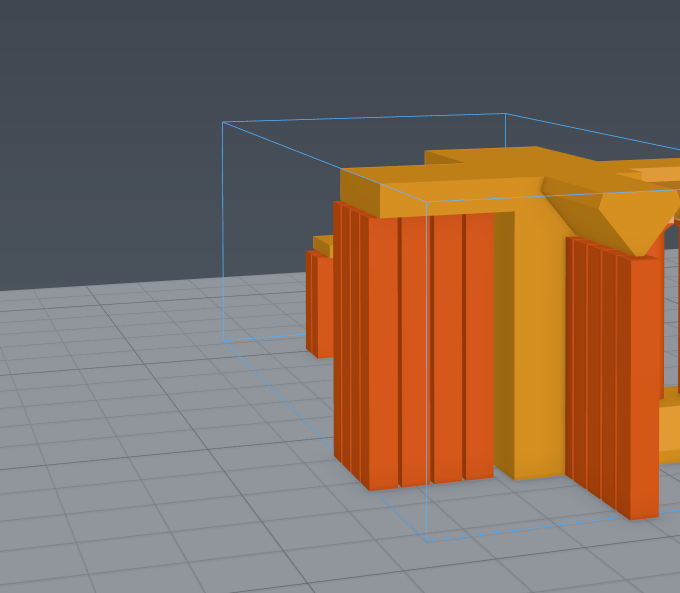

*Beispiel für gerade Pfeilerstützen.*

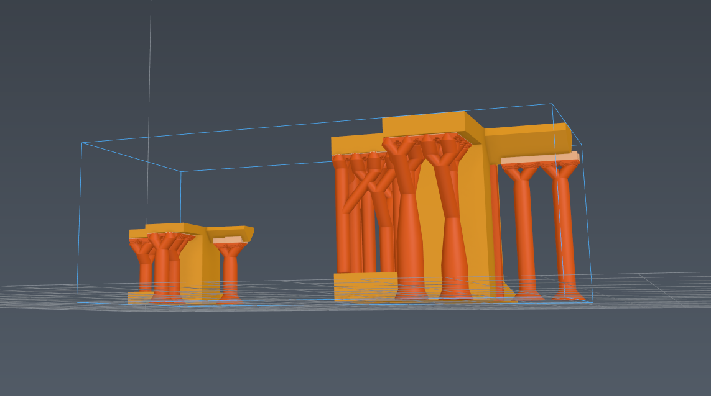

*Beispiel für Baumstützen mit verzweigten Kontaktstellen.*

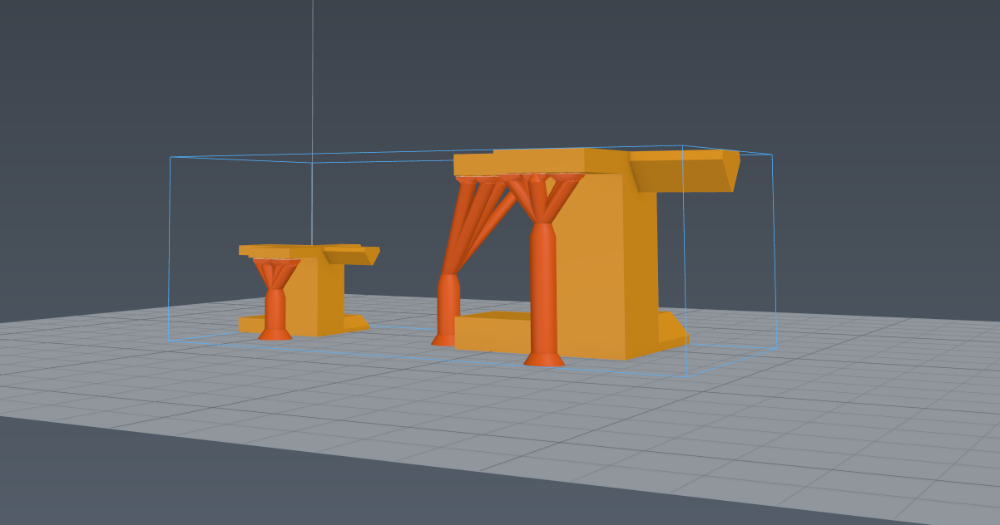

*Beispiel für Fächerstützen.*

*Das Stützwerkzeug mit Einstellungen und Knotenblech-Beispiel.*

## 6. Slicen und Vorschau prüfen

Prüfe zuerst, dass im Prozess sowohl ein Drucker als auch ein Filament beziehungsweise Material ausgewählt sind. Fehlt eine Auswahl, kann nicht gesliced werden. Klicke danach auf **Jetzt slicen**. Das Programm bereitet das Ergebnis zunächst vor; dabei wird noch kein endgültiger Speicherort abgefragt. Status und eventuelle Warnungen beachten.

In der G-Code-Vorschau kannst du den Schichtbereich eingrenzen und Werkzeugwege beziehungsweise Farben auswählen. Die aktuelle Schicht wird hervorgehoben. Prüfe besonders erste Schicht, Überhänge, Stützen, Kontaktstellen, Fahrwege und die geschätzten Druckwerte. Mit **Vorschaumodus verlassen** oder dem Modell-Reiter kehrst du zur Bearbeitung zurück; nach Änderungen erneut slicen.

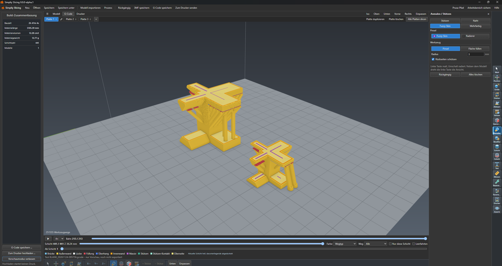

*Die farbige Vorschau mit Schichtreglern und Build-Zusammenfassung.*

## 7. G-Code speichern oder hochladen

Nach erfolgreichem Slicing **G-Code speichern** wählen und den gewünschten Speicherort angeben. Alternativ kannst du bei eingerichtetem und unterstütztem Drucker **Zum Drucker senden** verwenden. Der Upload ist ein eigener Schritt; kontrolliere Drucker und Datei vor einem Druckstart. Für Maschinenverbindung und Authentifizierung die Anforderungen deines Druckers beachten und Zugangsdaten nicht in öffentlichen Fehlerberichten teilen.

## 8. Querschnitt und weitere Werkzeuge

Mit **Querschnitt** lässt sich eine Schnittebene zur Ansicht aktivieren und verschieben, um Modell und Stützen von innen zu betrachten. Die Anzeige verändert das Modell dabei nicht. Weitere Werkzeuge stehen je nach aktuellem Entwicklungsstand in der rechten Leiste zur Verfügung; angezeigte oder deaktivierte Funktionen sind nicht automatisch für jeden Anwendungsfall vollständig geprüft.

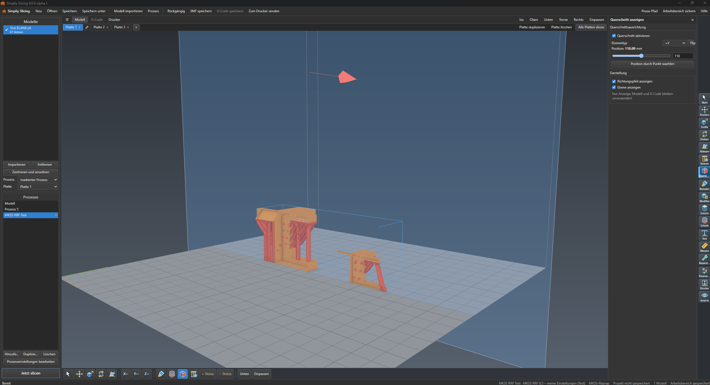

*Die Schnittebene zeigt den Innenbereich von Modell und Stützen.*

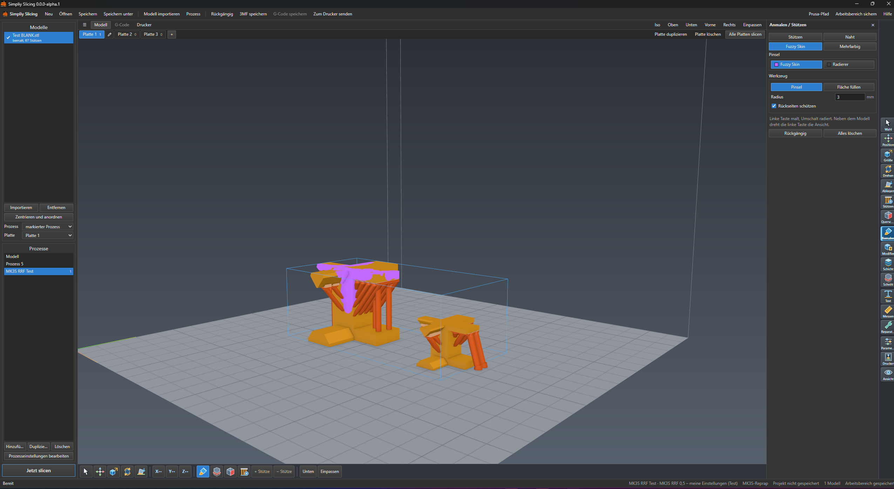

*Beispiel für die Markierung von Modellbereichen mit dem Malwerkzeug.*

## 9. Hilfe bei Problemen

- **Engine nicht gefunden:** PrusaSlicer separat installieren und den Pfad über **Prusa-Pfad** auswählen.
- **Slicing-Warnung:** Meldung lesen, Drucker-/Materialprofil, Modell und Stützstellen prüfen und erneut slicen.
- **Modell oder Stützen sehen unerwartet aus:** Ausrichtung und Druckplatte kontrollieren, Stützen nach Geometrieänderungen prüfen und die Schichten einzeln ansehen.
- **Fehler melden:** Auf [GitHub Issues](https://github.com/Michaelrossm/Simpliy-Slicing/issues) Version, Schritte und gegebenenfalls Bilder angeben. Private Dateien, IP-Adressen und Zugangsdaten vorher entfernen.

**Wichtig:** Dies ist eine frühe Alpha. Prüfe G-Code, Temperaturen, Maschinenlimits und Stützen vor jedem Druck. Bei neuen Einstellungen einen überwachten Testdruck durchführen. Simpliy Slicing ist kein offizielles Produkt von Prusa Research.
