# Simpliy Slicing – Windows user guide

[**Deutsch 🇩🇪**](ANLEITUNG.md) · **English 🇬🇧**

This guide describes the early **0.0.0-alpha.1** release. The application UI in this release is primarily German; German button names are given in parentheses to help you find them. The UI and features may change in future versions.

## 1. Install and launch

1. Download the Windows ZIP from the [release page](https://github.com/Michaelrossm/Simpliy-Slicing/releases/tag/v0.0.0-alpha.1) and extract it completely into a dedicated folder.
2. Make sure Microsoft Edge WebView2 Runtime is installed.
3. Install PrusaSlicer separately. Simpliy has been tested with **PrusaSlicer 3.0.0-alpha14**. The engine is not included in the ZIP; find the official download at [PrusaSlicer releases](https://github.com/prusa3d/PrusaSlicer/releases).
4. Run `simpliy-slicing.exe`. If Simpliy does not find the engine, use **Prusa path** (`Prusa-Pfad`) to select the installed executable.

Simpliy starts PrusaSlicer as a separate background process. A compatible version is required for slicing.

## 2. Configure printer and material

See the [illustrated first-time setup](ersteinrichtung/README_EN.md) for screenshots of the initial engine, base configuration, and printer setup.

**Both a printer and a filament/material must be selected before slicing.** Choose an existing printer and a matching material profile, or configure your own. Verify the actual bed size, build height, nozzle diameter, firmware, G-code flavor, start/end scripts, temperatures, and filament diameter. Available presets depend on the installed engine.

## 3. Import and position a model

1. Click **Import model** (`Modell importieren`) and choose the model file.
2. Select the model in the list on the left. Use the tools to move, rotate, scale, and lay it on the build plate.
3. Confirm the model stays inside the printable volume. You can organize additional models on the same or another plate.
4. Save your project before making extensive changes.

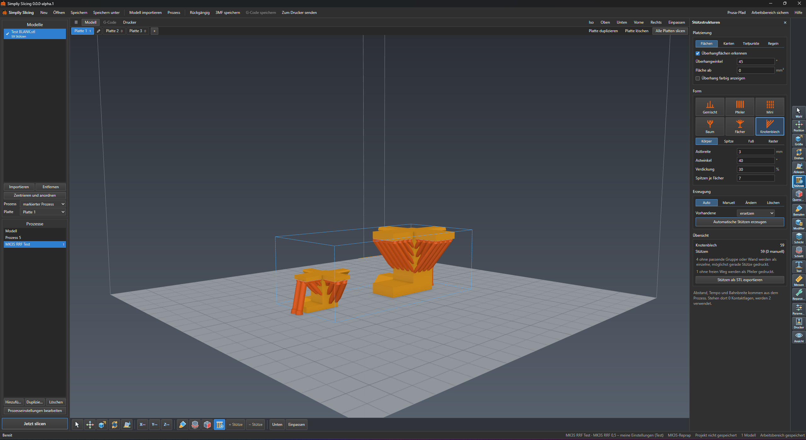

*Model list on the left, build plate in the middle, support tools on the right.*

## 4. Processes and print settings

A process is a collection of print settings. Select a process in the left panel and click **Process** (`Prozess`) to open **Edit process settings** (`Prozesseinstellungen bearbeiten`). The tabs include extruders, layers, walls, infill, supports, temperatures, cooling, speeds, printers, and scripts.

Use **Select models** (`Modelle auswählen`) to assign models to the process. Changes initially apply to the current process. Use **Save process** (`Prozess speichern`) to keep configurations permanently. Custom height regions are still under development in this alpha.

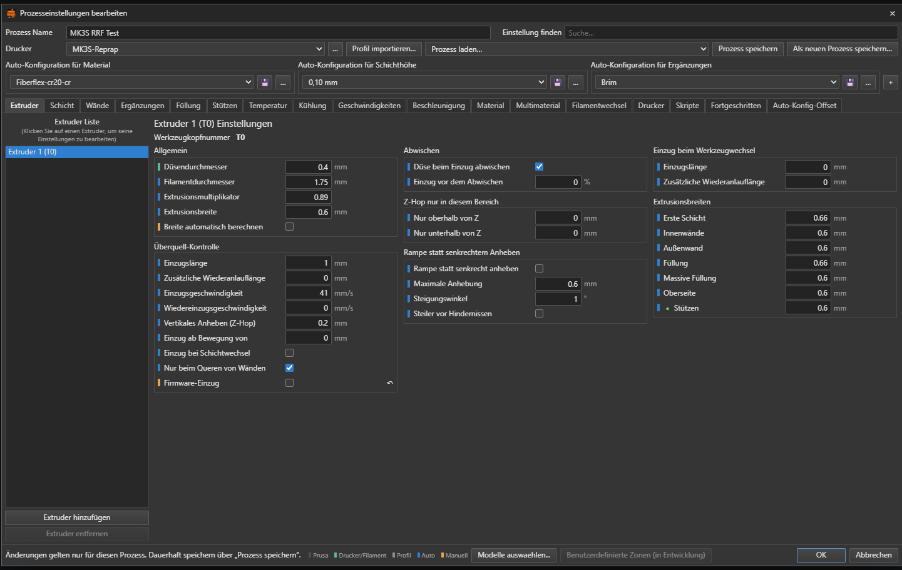

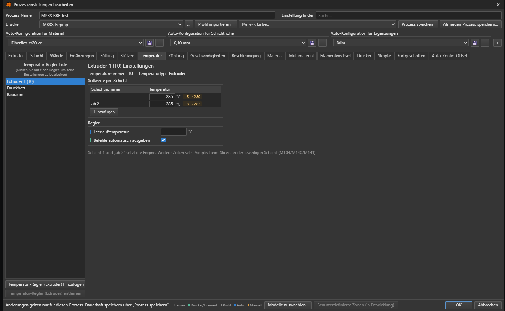

### Auto-configuration

Auto-configuration lets you select related settings, such as material or layer height, together. In the assignment dialog, choose which category controls each parameter. Offset rules can modify effective slicing values depending on the selected option. Verify the resulting values before slicing.

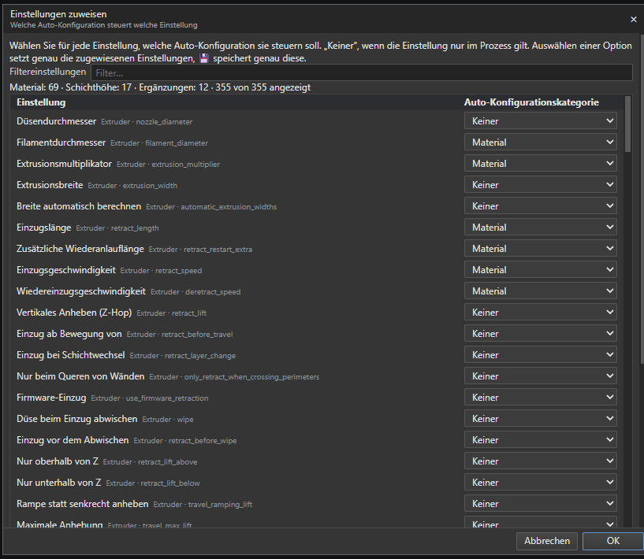

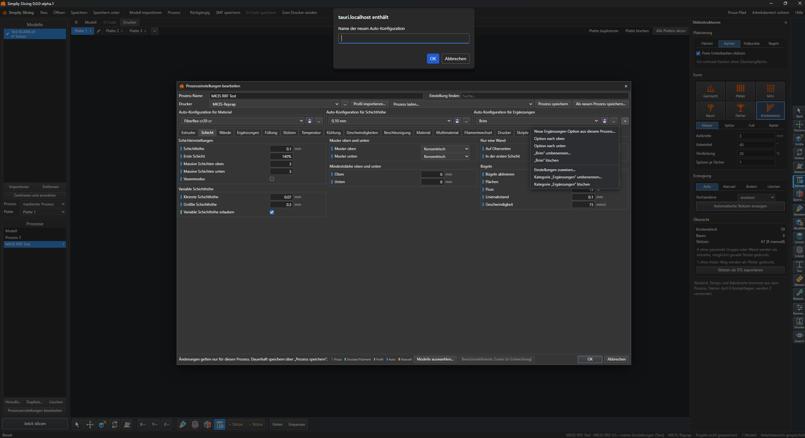

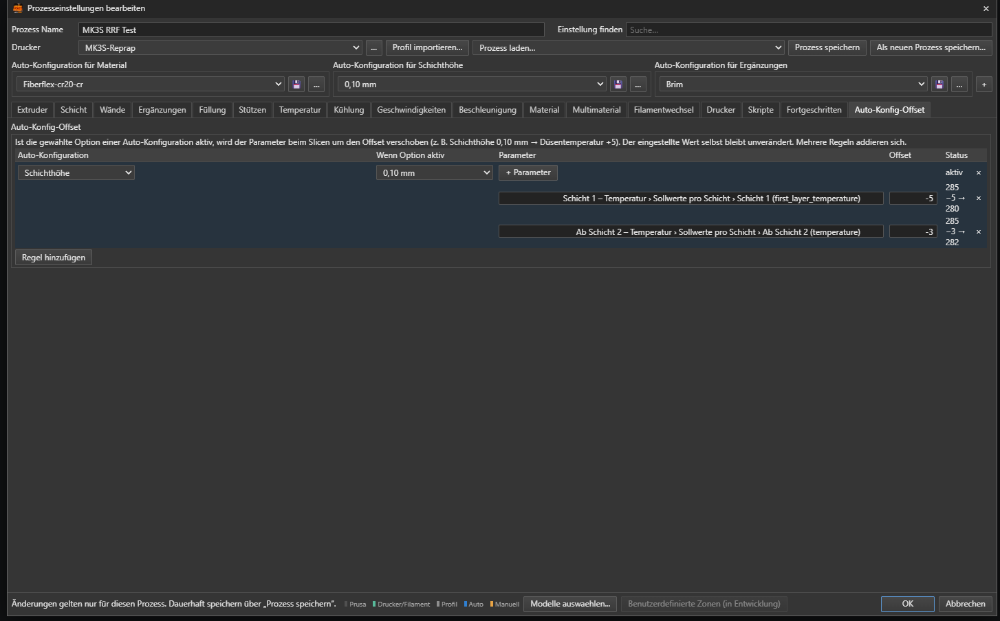

## 5. Prepare supports

1. Select a model and open **Supports** (`Stützen`) on the right.
2. Choose a support shape, such as pillar, tree, fan, or gusset. Review the geometry and placement settings.
3. Generate supports automatically or use the manual tools. Inspect all contact points from several viewing angles.
4. Set contact distances and other printing parameters in the relevant process; recheck supports after repositioning models.

Simpliy checks the combination of its custom supports with automatic engine supports during slicing. Protection regions may limit automatic support generation locally. If validation fails or cannot be performed, Simpliy can switch to a fallback and display a warning. **Use text G-code** for this combination. Preview checks do not replace a supervised test print.

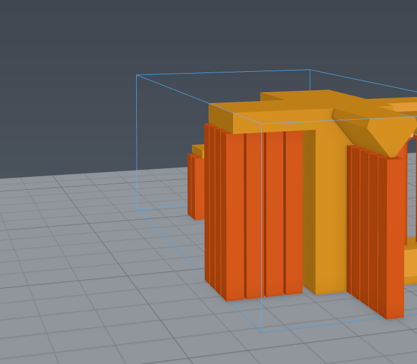

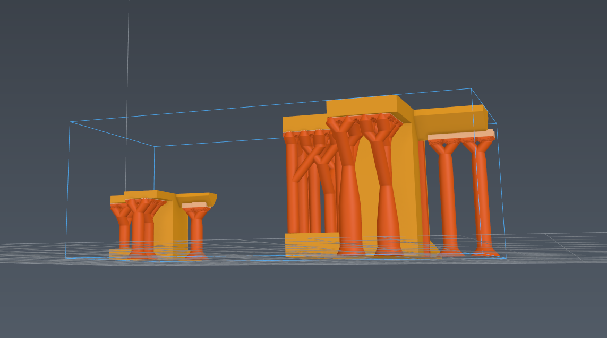

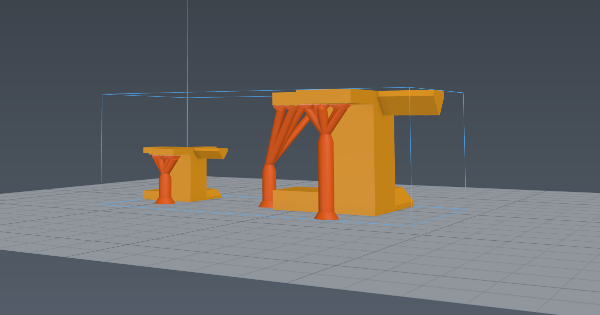

## 6. Slice and inspect the preview

First verify that both printer and material are selected in the process. Click **Slice now** (`Jetzt slicen`). The program prepares the result without immediately asking for an export location. Review progress and any warnings.

The G-code preview lets you inspect layers, toolpaths, and color-coded regions. Pay special attention to the first layer, overhangs, support contacts, travel moves, and estimated print values. Use **Exit preview** (`Vorschaumodus verlassen`) to return to editing. Re-slice after changes.

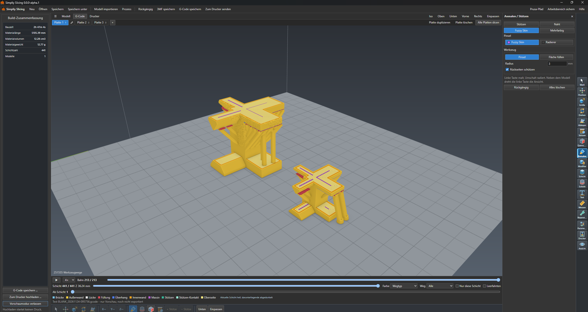

## 7. Save or upload G-code

Once slicing has finished, select **Save G-code** (`G-Code speichern`) and choose an output location. Alternatively, use **Send to printer** (`Zum Drucker senden`) for a supported, configured network printer. Uploading is a separate action; verify the file and destination before printing. Never share device credentials or API keys in public issue reports.

## 8. Cross-section and additional tools

The **Cross-section** (`Querschnitt`) tool lets you move a viewing plane through models and supports without changing their geometry. Additional tools are available in the right-hand toolbar depending on current development status. Not every displayed tool has been fully tested in all situations.

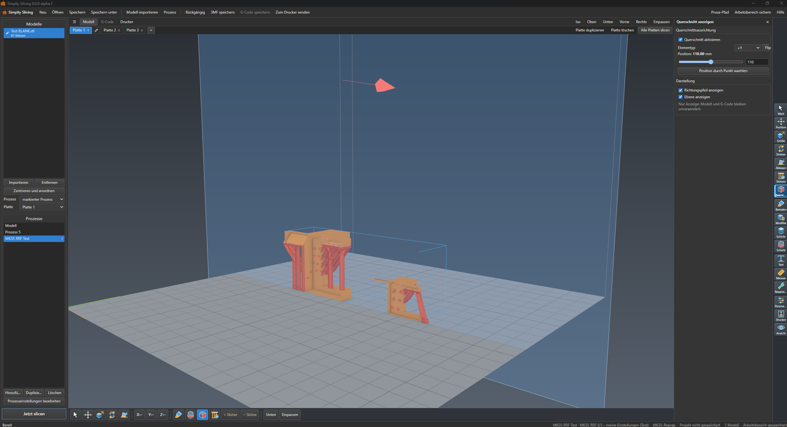

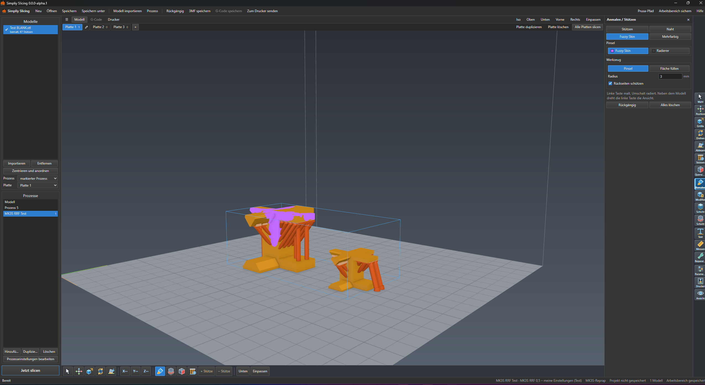

## 9. Troubleshooting

- **Engine not found:** Install PrusaSlicer separately and select its executable using `Prusa-Pfad`.
- **Slicing warning:** Read the message, check the printer/material configuration, model, and support contact areas, then slice again.
- **Unexpected model/support appearance:** Verify model orientation and plate placement, regenerate supports if needed, and inspect individual layers.
- **Report a bug:** Create a [GitHub issue](https://github.com/Michaelrossm/Simpliy-Slicing/issues), specifying the Simpliy version, steps to reproduce, and screenshots. Remove private data, IP addresses, and passwords.

**Safety:** This is early alpha software. Always check G-code, temperatures, machine limits, and supports before printing, and supervise initial test prints. Simpliy Slicing is not an official product of Prusa Research.
