# Simpliy Slicing

**Modelle vorbereiten, Stützen gestalten und Druckbahnen kontrollieren – in einer Windows-Anwendung.** Simpliy Slicing kombiniert eine eigene Oberfläche mit der separat installierten Slicing-Engine von PrusaSlicer. Das Projekt befindet sich in einer frühen Alpha-Phase.

[**Windows-Alpha herunterladen**](../../releases/tag/v0.0.0-alpha.1) · [Alle Releases](../../releases) · [Fehler melden](../../issues)

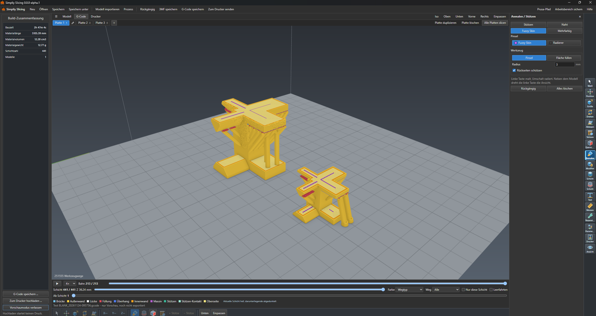

## Was kann Simpliy Slicing?

### Modelle und Druckplatten

Importiere Modelle, platziere und richte sie auf der virtuellen Druckplatte aus. Modelle lassen sich Prozessen zuweisen und auf mehreren Platten organisieren. Ein Projekt kann gespeichert und später weiterbearbeitet werden. Die Werkzeugleiste bietet unter anderem Positionieren, Skalieren, Drehen, Ablegen, Messen und Modellbearbeitung.

### Eigene Stützstrukturen

Das Stützwerkzeug bietet verschiedene Formen wie **Pfeiler, Baum, Fächer und Knotenblech**. Überhänge lassen sich automatisch untersuchen; Stützen können auch manuell bearbeitet werden. Form, Spitze, Fuß und Platzierung werden im Werkzeug eingestellt. Die erzeugten Stützen werden für das Slicing vorbereitet und zusammen mit dem Modell dargestellt.

| Baum | Fächer |
| --- | --- |
| 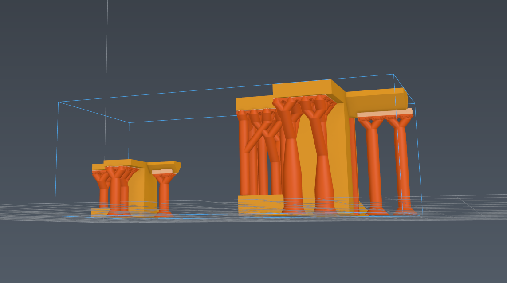 | 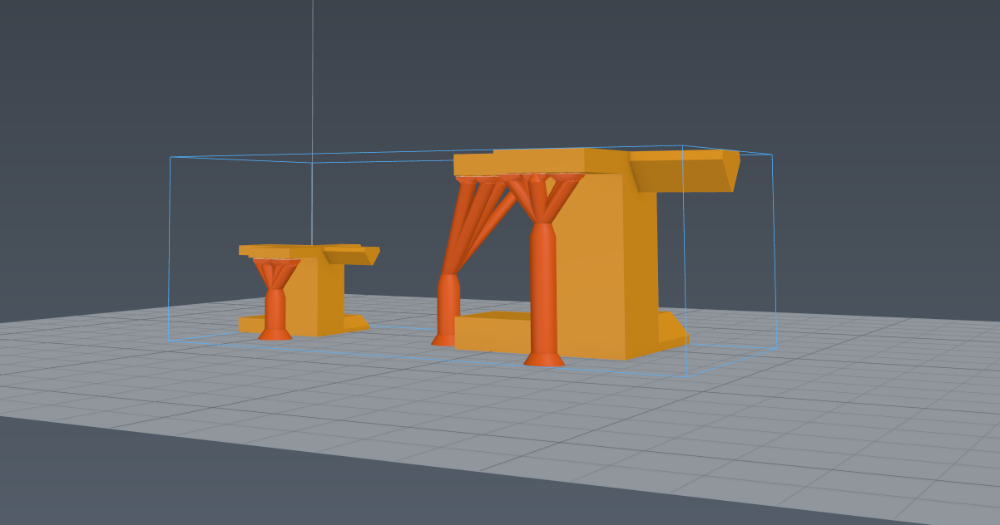 |

| Pfeiler | Knotenblech und Stützwerkzeug |
| --- | --- |
| 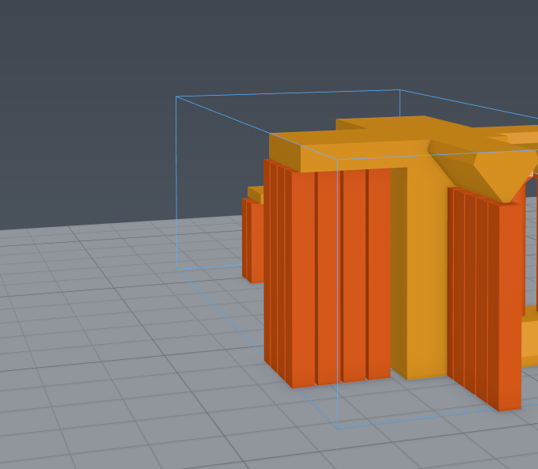 | 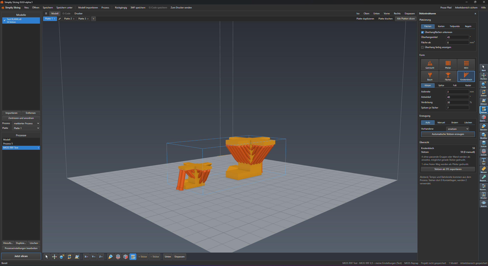 |

Die Kombination eigener Stützen mit automatischen Stützen der Engine wird anhand des Slicing-Ergebnisses geprüft. Schutzbereiche können die automatische Erzeugung lokal einschränken. Wenn ein Versuch nicht geprüft werden kann oder die Prüfung fehlschlägt, weist das Programm auf den Rückfall hin. Für diese Kombination Text-G-Code verwenden. Stützen und Kontaktbereiche vor dem Druck immer in der Vorschau kontrollieren.

### Prozesse, Profile und Auto-Konfiguration

Im Prozessdialog bearbeitest du Einstellungen für Extruder, Schichten, Wände, Füllung, Stützen, Temperaturen, Kühlung, Geschwindigkeiten, Drucker und Skripte. Prozesse können Modellen zugewiesen und gespeichert werden. Auto-Konfigurationen bündeln Einstellungen, beispielsweise für Material, Schichthöhe oder Ergänzungen; Zuweisungen und Offsets lassen sich bearbeiten.

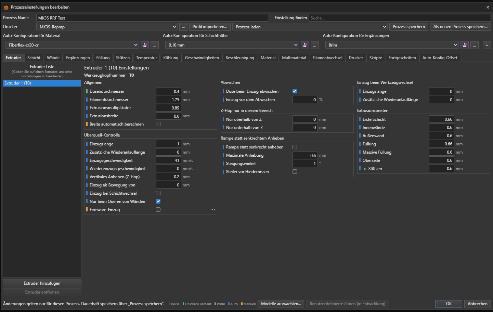

| Einstellungen zuweisen | Offset-Regeln |
| --- | --- |
| 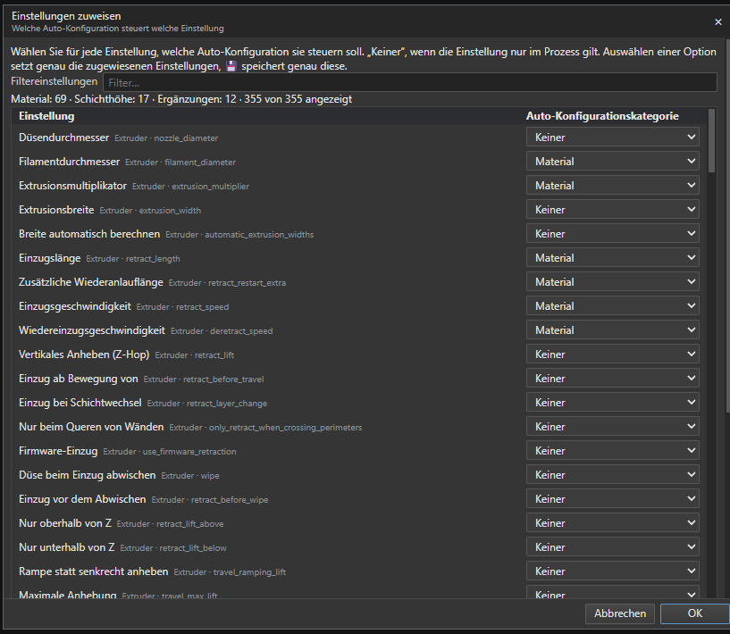 | 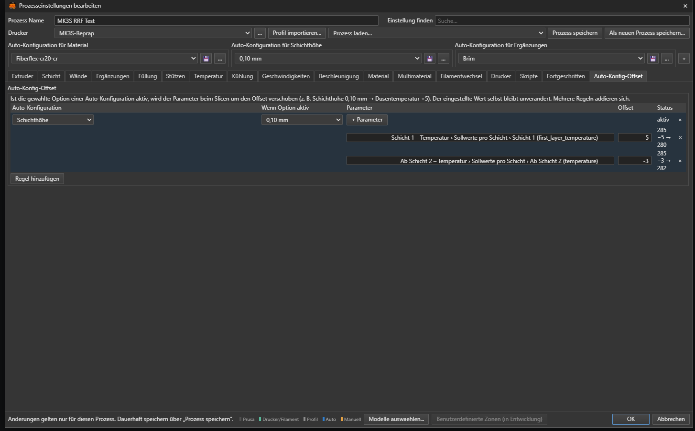 |

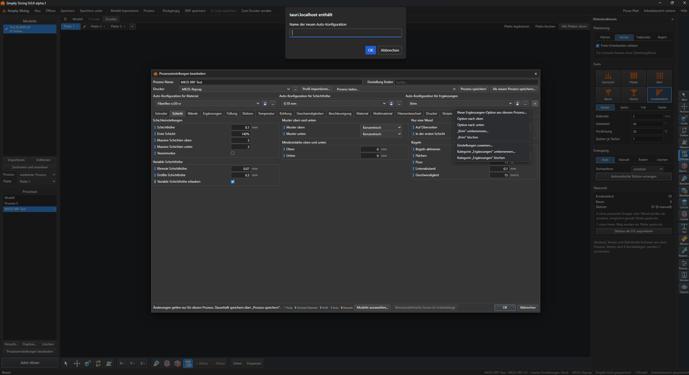

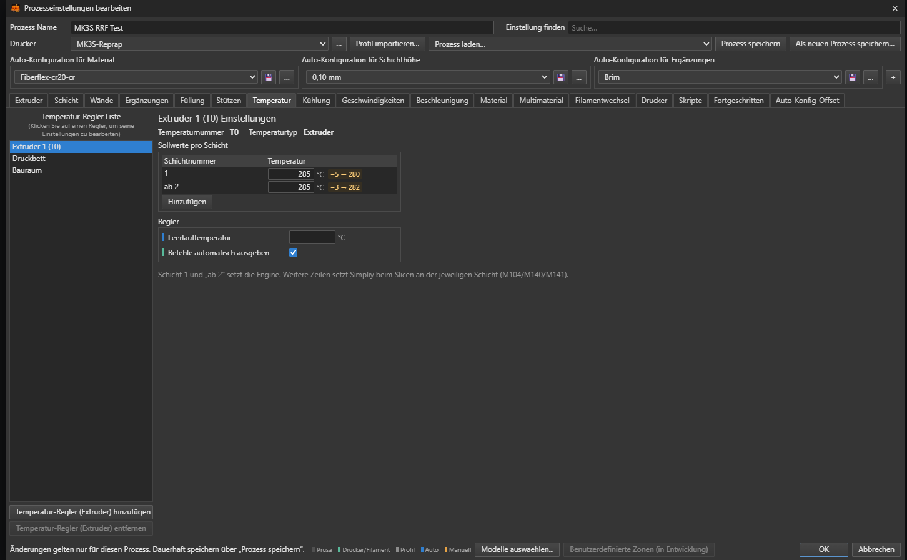

### Vorschau und Modellkontrolle

Nach dem Slicen zeigt die Vorschau Schichten und Werkzeugwege farbig an. Über die Schicht- und Bahnregler lassen sich Druckbereiche betrachten; die Zusammenfassung zeigt unter anderem geschätzte Zeit und Material. Der Querschnitt hilft beim Blick in Modell und Stützstruktur. Für unterstützte Funktionen können Bereiche am Modell markiert werden.

| Querschnitt | Bereiche bemalen |
| --- | --- |
| 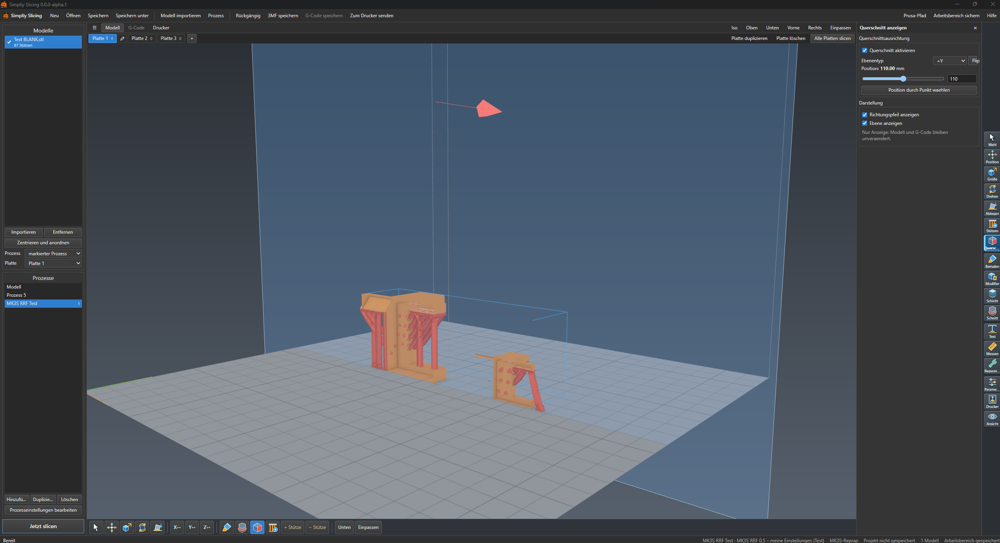 | 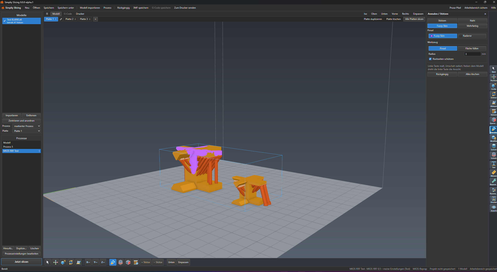 |

G-Code wird nach der Vorbereitung ausdrücklich gespeichert oder an einen entsprechend eingerichteten Drucker hochgeladen. Welche Funktionen verfügbar sind, hängt von Engine, Drucker und gewählter Konfiguration ab.

## Download und Start

1. Unter [Releases](../../releases) das ZIP für Windows herunterladen und vollständig entpacken.
2. **Microsoft Edge WebView2 Runtime** und eine kompatible PrusaSlicer-Version installieren. Getestet wurde die Engine **3.0.0-alpha14**; PrusaSlicer ist nicht im Paket enthalten und kann vom [offiziellen Projekt](https://github.com/prusa3d/PrusaSlicer/releases) bezogen werden.
3. `simpliy-slicing.exe` starten. Falls erforderlich, den Pfad zur installierten Engine im Programm auswählen.
4. Drucker- und Materialprofil prüfen, Modell importieren, Stützen einstellen und slicen.
5. Schichten, Kontaktstellen und Druckparameter prüfen; danach G-Code speichern oder hochladen.

## Status und Grenzen

Dies ist eine **frühe Alpha-Version**, keine fertige Produktionssoftware. Funktionen und Oberfläche können sich ändern. Ein erfolgreicher Slice garantiert keinen erfolgreichen oder sicheren Druck; prüfe insbesondere G-Code, Temperaturen, Druckvolumen und Stützstellen und verwende für neue Einstellungen einen überwachten Testdruck. Benutzerdefinierte Zonen sind in dieser Version noch in Entwicklung.

Simpliy Slicing ist ein eigenständiges Projekt und kein offizielles Produkt von Prusa Research. Es verwendet eine separat installierte PrusaSlicer-Engine als Hintergrundprozess. Die Screenshots zeigen die Alpha-Oberfläche und können von späteren Versionen abweichen.

## Feedback und Quellcode

Fehler und Verbesserungsvorschläge sind unter [Issues](../../issues) willkommen. Bitte Version, Schritte zur Reproduktion und gegebenenfalls geeignete Bilder angeben; keine Zugangsdaten oder privaten Druckerinformationen veröffentlichen. Der Quellcode wird derzeit privat entwickelt und ist in diesem öffentlichen Repository nicht enthalten. Hinweise zu Lizenz und Drittanbieterkomponenten liegen dem Release bei.
