# Simpliy Slicing

[**Deutsch 🇩🇪**](README.md) · **English 🇬🇧**

**Prepare models, design supports, and inspect toolpaths — in one Windows application.** Simpliy Slicing combines its own user interface with the separately installed PrusaSlicer slicing engine. This project is at an early alpha stage.

[**Download Windows alpha**](../../releases/tag/v0.0.0-alpha.1) · [English release notes](RELEASE_NOTES_EN.md) · [All releases](../../releases) · [User guide](ANLEITUNG_EN.md) · [Illustrated first-time setup](ersteinrichtung/README_EN.md) · [Report an issue](../../issues)

**Open-source sources for MPL-2.0 dependencies:** [Download the source archive](../../releases/download/v0.0.0-alpha.1/Simpliy-Slicing-0.0.0-alpha.1-MPL-Sources.zip) · [Dependencies and licensing notes](OPEN-SOURCE-QUELLCODE_EN.md). Simpliy's own proprietary source code is not included.

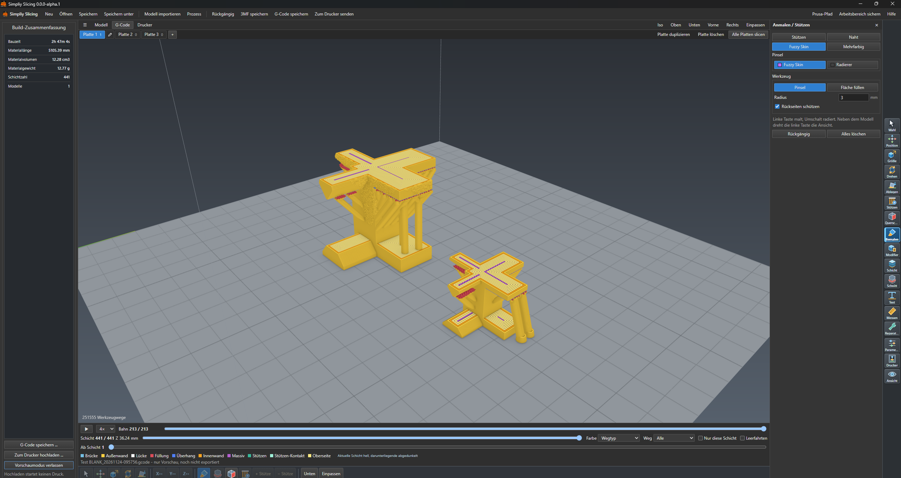

## What does Simpliy Slicing offer?

### Models and build plates

Import models, place and orient them on a virtual build plate, assign them to processes, and organize multiple plates. You can save your project and return to it later. The toolbar includes positioning, scaling, rotation, laying models flat, measuring, and model-editing tools.

### Custom support structures

The support tools include **pillar, tree, fan, and gusset supports**. You can analyze overhangs, create supports automatically, or edit them manually. Positioning, geometry, tips, and feet are configurable. Simpliy prepares these support geometries for slicing and displays them together with the model.

| Tree supports | Fan supports |
| --- | --- |
| 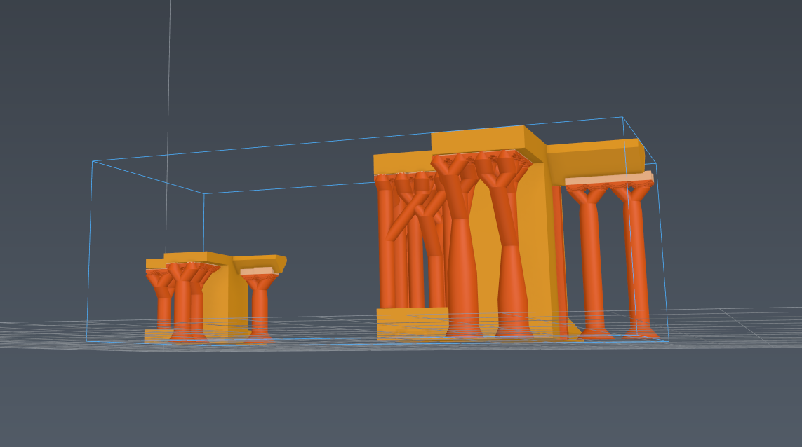 | 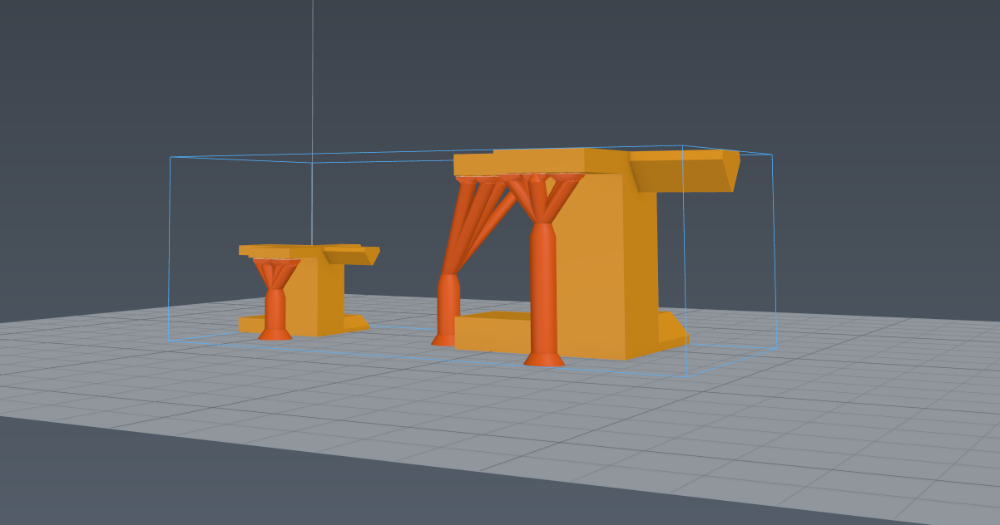 |

| Pillar supports | Gussets and support tools |
| --- | --- |
| 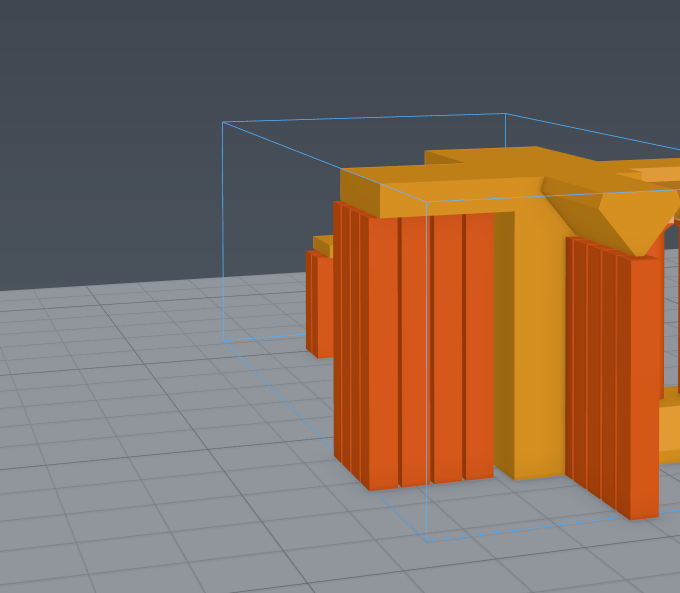 | 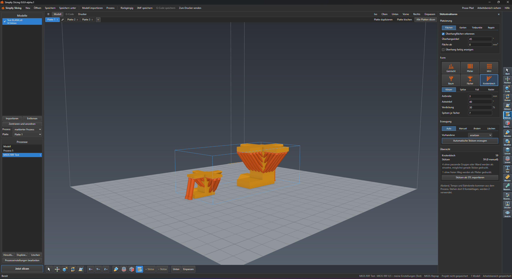 |

Combining Simpliy's custom supports with supports generated by the engine is checked against the slicing result. Protection regions may locally restrict automatic support generation. If the result cannot be validated or validation fails, the application reports a fallback. **Use text G-code** for this combined mode. Always inspect supports and contact areas in the preview before printing.

### Processes, profiles, and auto-configuration

The process dialog brings together extruder, layer, wall, infill, support, temperature, cooling, speed, printer, and script settings. Processes can be assigned to models and saved. Auto-configuration groups settings such as material, layer height, and additional features; assignments and offsets can be adjusted.

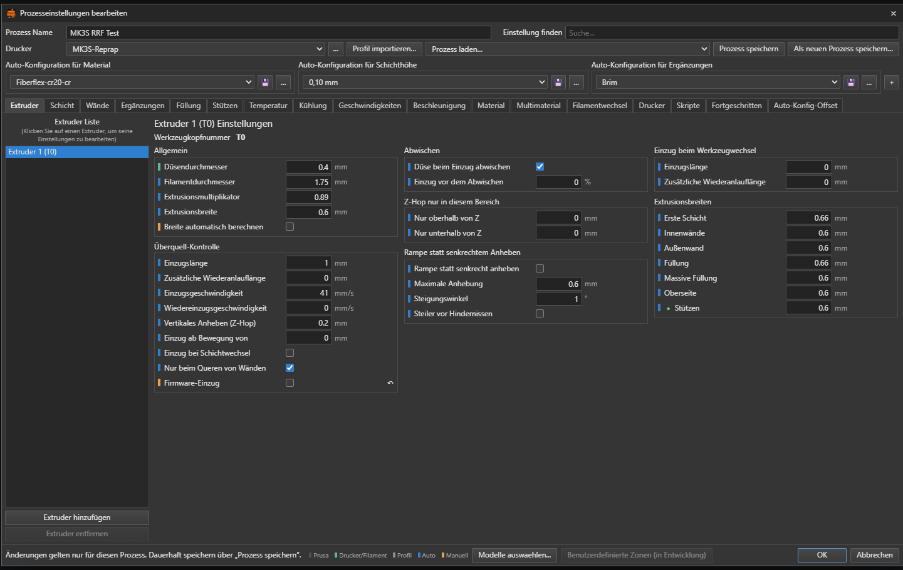

| Setting assignments | Offset rules |
| --- | --- |
| 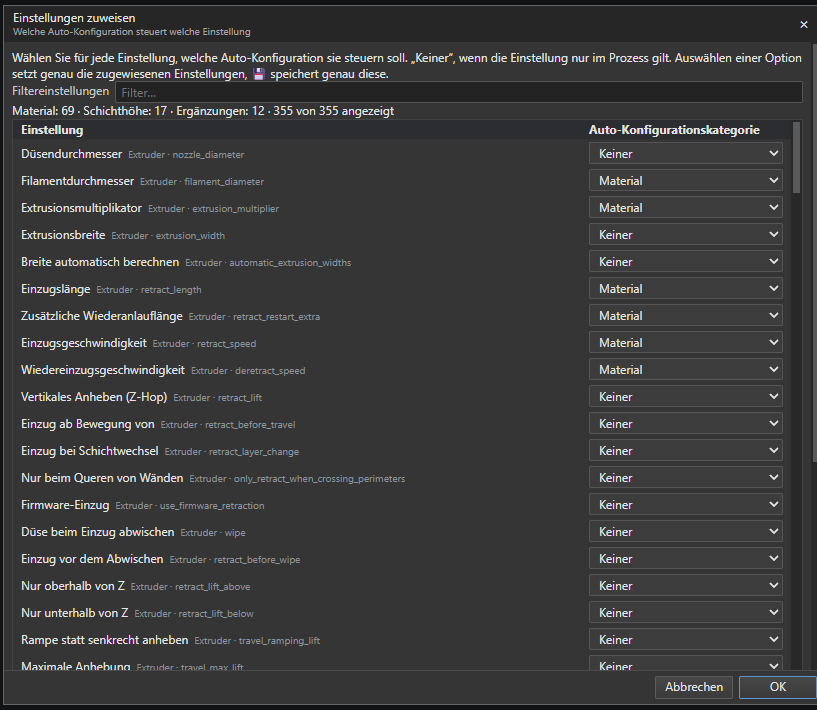 | 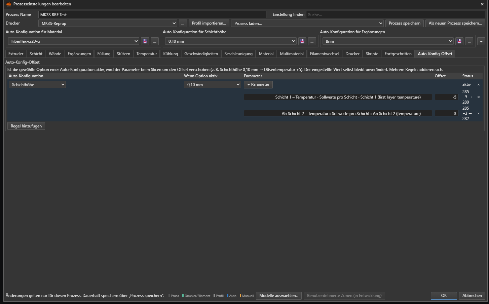 |

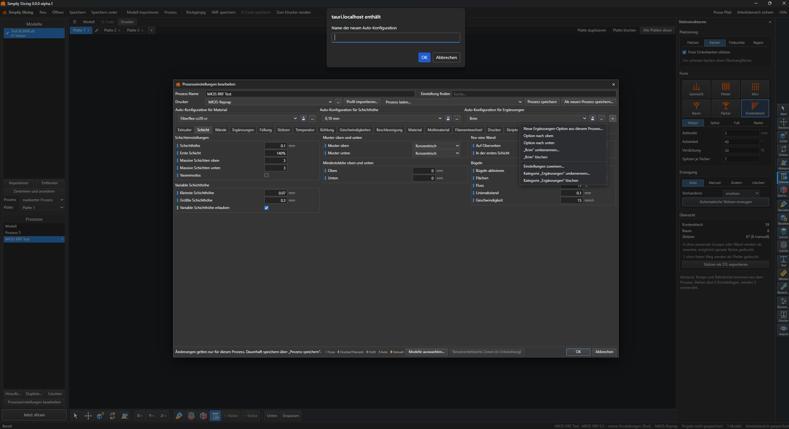

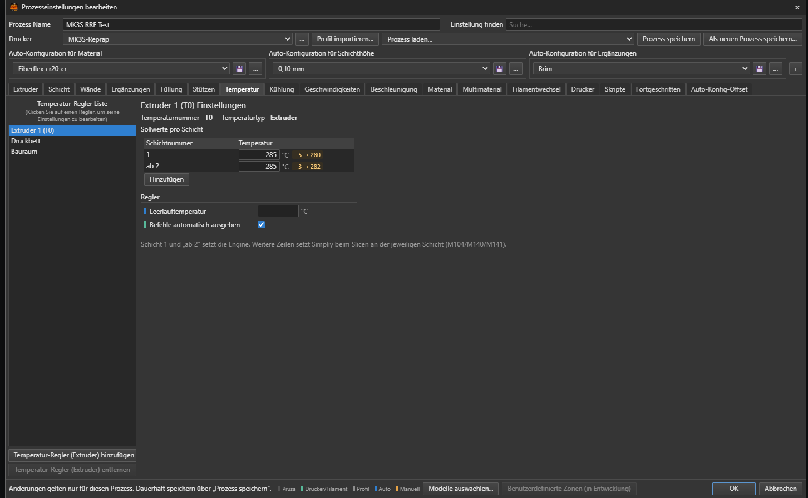

### Preview and model inspection

After slicing, the preview displays layers and toolpaths in different colors. Layer and move controls let you inspect individual regions; the summary includes estimated print time and material usage. A cross-section view helps inspect the interior of models and supports. Supported marking tools let you paint selected areas on a model.

| Cross-section | Painting model areas |
| --- | --- |
| 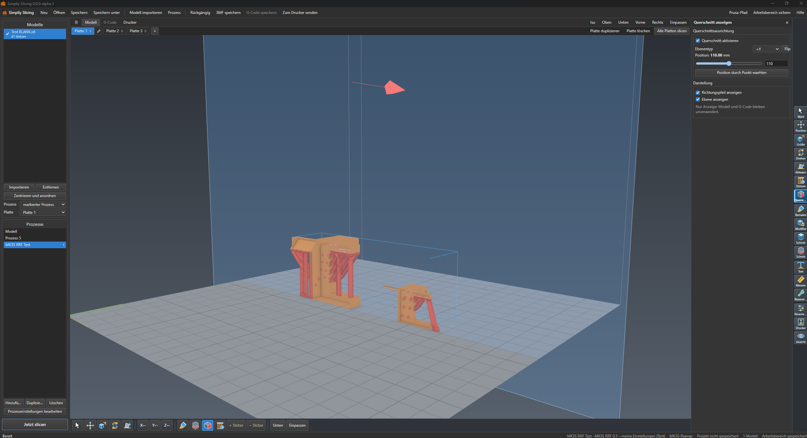 | 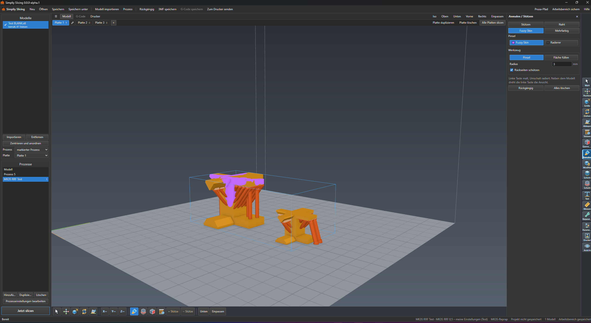 |

After preparing the project, you explicitly save the G-code or upload it to a configured printer. Available features depend on the engine, printer, and selected configuration.

## Download and getting started

1. Download the [Windows ZIP from Releases](../../releases) and extract it completely.
2. Ensure **Microsoft Edge WebView2 Runtime** and a compatible PrusaSlicer version are installed. The tested engine version is **3.0.0-alpha14**. PrusaSlicer is **not bundled** and is available from the [official project](https://github.com/prusa3d/PrusaSlicer/releases).
3. Launch `simpliy-slicing.exe`. Select the installed engine's path if necessary.
4. Verify printer and material profiles, import a model, configure supports, and slice.
5. Inspect layers, contact regions, and print settings, then save or upload the G-code.

**Note about the interface:** The screenshots and the released alpha.1 application currently show German UI labels. The [English guide](ANLEITUNG_EN.md) also mentions the original German button labels so you can follow along.

## Status and limitations

This is an **early alpha**, not production-ready software. Features and layout may change. A successful slice does not guarantee a safe or successful print. Carefully inspect G-code, temperatures, build volume, and support contact regions; supervise initial test prints. Custom height regions are still under development in this version.

Simpliy Slicing is an independent project and **is not an official Prusa Research product**. It calls a separately installed PrusaSlicer engine as a background process. Screenshots show the alpha interface and may differ from future versions.

## Feedback and source code

Bug reports and suggestions are welcome in [GitHub Issues](../../issues). Please provide your app version, reproduction steps, and suitable screenshots. Never share credentials or private printer information.

Simpliy's own source code is developed privately and is **not published in this repository**. The released package contains its license documentation and third-party notices. The [MPL dependency source archive](../../releases/download/v0.0.0-alpha.1/Simpliy-Slicing-0.0.0-alpha.1-MPL-Sources.zip) is published separately; this does not resolve every licensing question concerning Prusa-compatible format modules.
