# Simpliy Slicing – Ersteinrichtung Schritt für Schritt

Aufgenommen am 24.11.2026 mit 0.0.0-alpha.1 bei einem echten Erststart (leerer Datenordner).

## 1. Erster Start

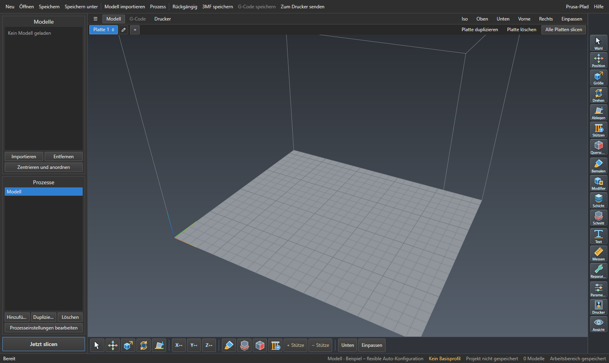

Beim ersten Start ist ein Beispielprozess geladen. Unten rechts steht **„Kein Basisprofil“**: Zum Slicen fehlt noch die Grundlage.

> **Erforderlich:** Wähle im Prozess einen Drucker und ein Filament beziehungsweise Material aus. Fehlt eines von beiden, ist Slicen nicht möglich.

## 2. Slicing-Engine prüfen (Hilfe › Slicing-Engine)

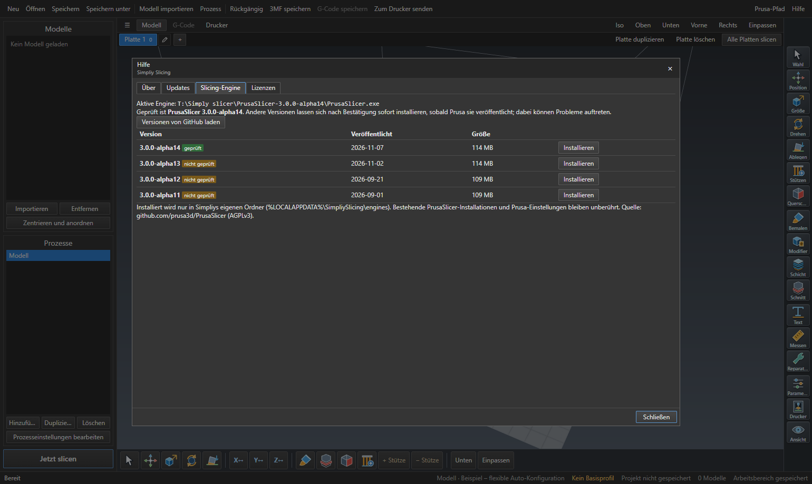

- Oben rechts auf **Hilfe** klicken, dann auf den Reiter **Slicing-Engine**.
- Unter „Aktive Engine“ steht der Pfad zur gefundenen PrusaSlicer-Engine.
- Fehlt sie, auf **„Versionen von GitHub laden“** klicken und bei **3.0.0-alpha14 (geprüft)** auf **Installieren** klicken.
- Andere Versionen gehen auch; dafür kommt vorher eine Warnung, die du bestätigen musst.
- Installiert wird nur in Simpliys eigenen Ordner, eine vorhandene PrusaSlicer-Installation bleibt unberührt.

## 3. Prozess öffnen

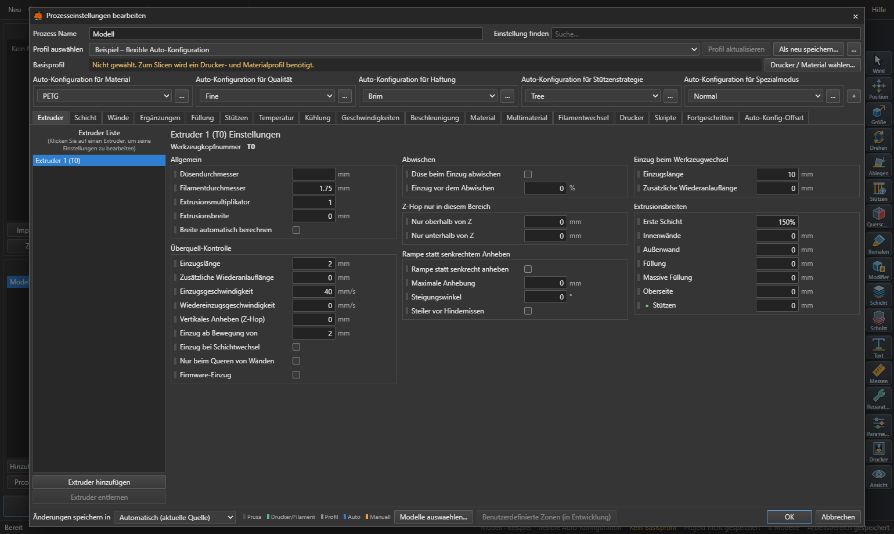

Oben in der Menüleiste auf **Prozess** klicken. Hier wird alles eingestellt: Drucker, Material, Schichthöhe und alle Druckwerte.

## 4. Basis wählen (einmalig)

Im Prozess oben rechts auf **„Drucker / Material wählen…“** klicken.

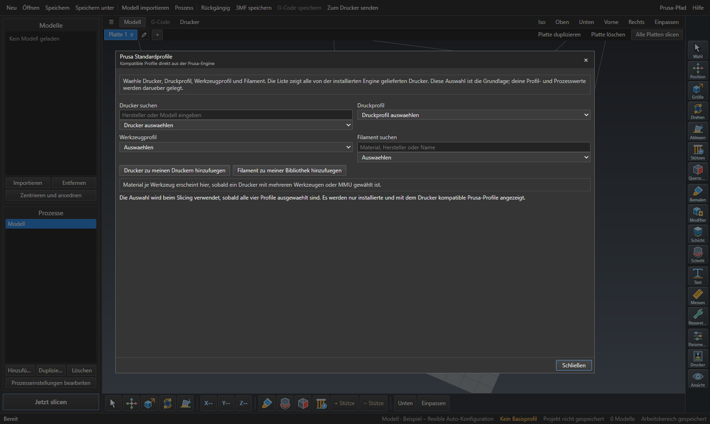

1. **Drucker:** „Simpliy Neutral (1 Tool)“ wählen. Hast du mehrere Extruder, nimm die passende „nT“-Variante.
2. **Druckprofil, Werkzeugprofil und Filament:** jeweils „Simpliy“ wählen.

Die Engine bekommt damit nur eine neutrale Konfiguration. Alle Werte kommen aus Simpliy.

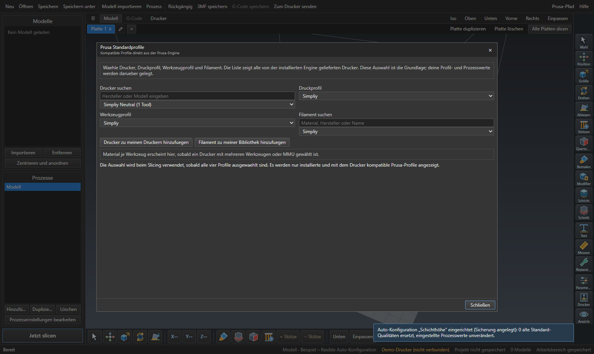

Danach erscheint unten der Hinweis, dass die Auto-Konfiguration „Schichthöhe“ eingerichtet wurde. Zum Schluss auf **Schließen** klicken.

## 5. Eigenen Drucker anlegen

Im Prozess neben dem Feld „Drucker“ auf **…** klicken.

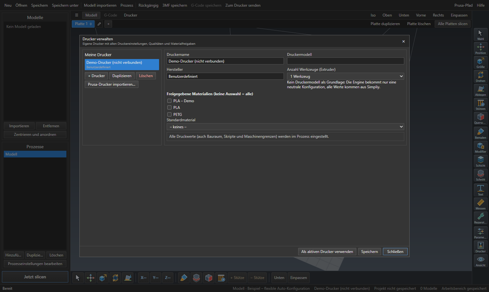

1. **+ Drucker** klicken.
2. Unter **Druckername** einen Namen eintragen, z. B. „Mein Drucker“.
3. **Anzahl Werkzeuge** einstellen.
4. Die freigegebenen Materialien und ein Standardmaterial kannst du hier festlegen. Für das Slicen muss anschließend im Prozess ein Filament beziehungsweise Material ausgewählt sein.
5. **Speichern** und dann **Schließen** klicken.

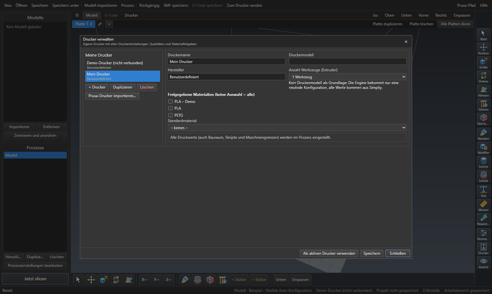

Danach im Prozess oben bei **Drucker** deinen neuen Drucker auswählen und bei **Auto-Konfiguration für Material** das gewünschte Filament beziehungsweise Material wählen. **Beide Auswahlen sind für das Slicen erforderlich.**

## 6. Druckerwerte im Prozess einstellen

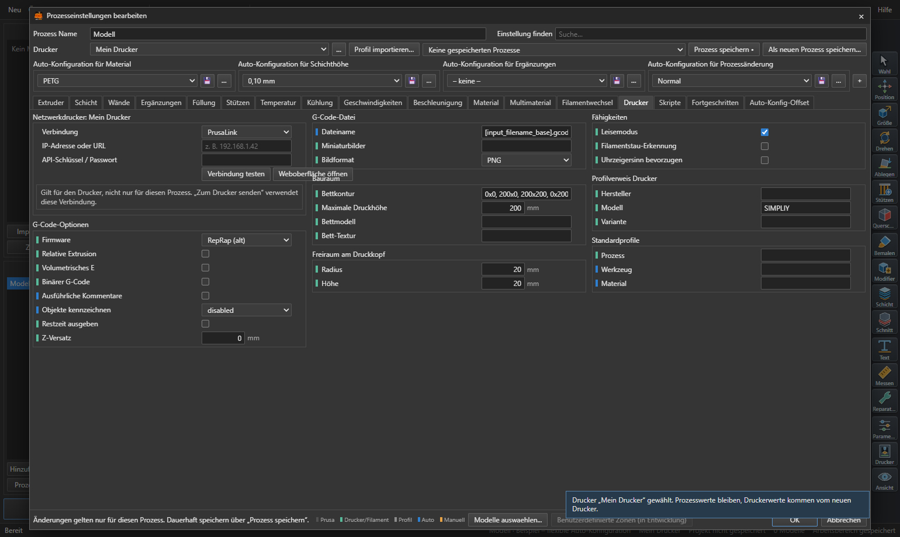

Im Reiter **Drucker**:

- **Firmware:** auf deine Firmware stellen, z. B. Marlin 2 oder Klipper.
- **Bettkontur** und **Maximale Druckhöhe:** deinen Bauraum eintragen.
- **Netzwerkdrucker:** IP-Adresse und API-Schlüssel eintragen, wenn du über „Zum Drucker senden“ hochladen willst.

Danach diese Reiter durchgehen:

- **Extruder:** Düsendurchmesser, Filamentdurchmesser und Einzug.
- **Temperatur:** Düse, Bett und Kammer, auch je Schicht.
- **Kühlung:** Lüfter.
- **Geschwindigkeiten:** inklusive Maschinengrenzen.
- **Skripte:** Start-G-Code und End-G-Code.

## 7. Prozess speichern

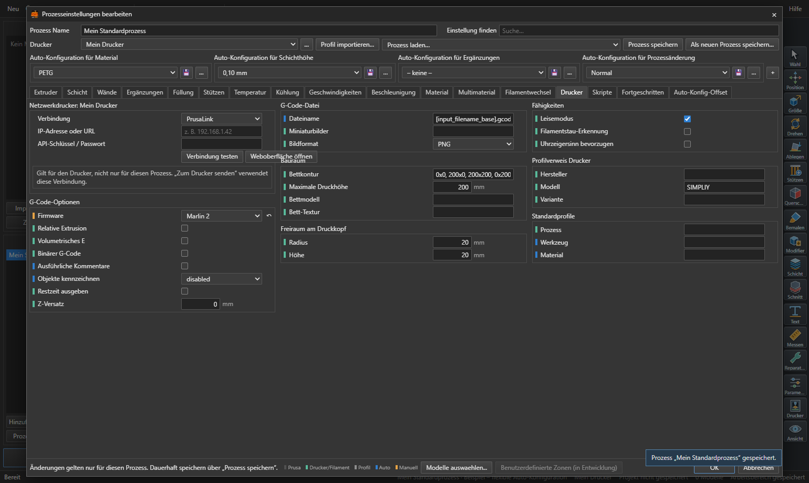

**„Als neuen Prozess speichern…“** klicken und einen Namen vergeben, z. B. „Mein Standardprozess“. Später überschreibst du ihn mit **„Prozess speichern“**. Mit **OK** schließt du den Dialog.

## 8. Modell laden und slicen

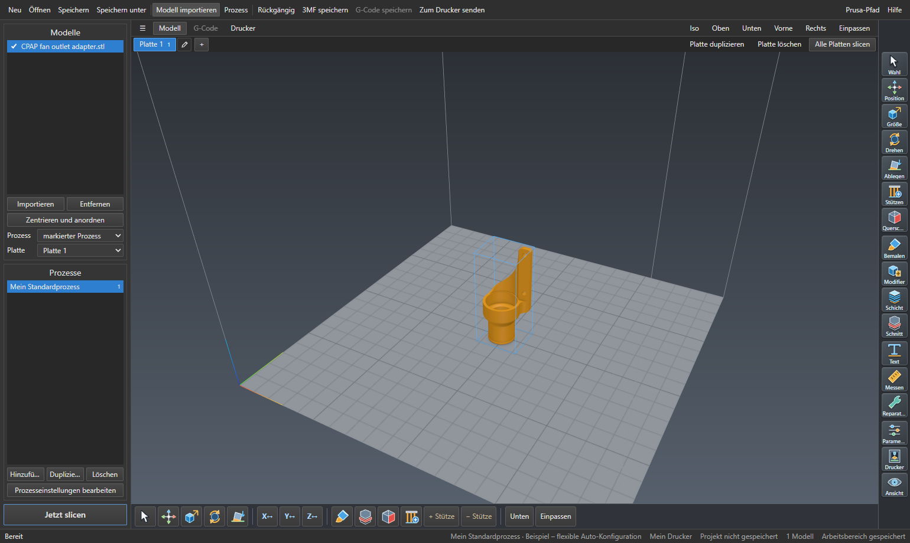

1. **Modell importieren** klicken und eine STL- oder 3MF-Datei wählen.
2. Im Prozess prüfen, dass **Drucker und Filament beziehungsweise Material ausgewählt** sind. Fehlt eines davon, kann nicht gesliced werden. Danach Schichthöhe und Ergänzungen wählen.
3. Links auf **Jetzt slicen** klicken.

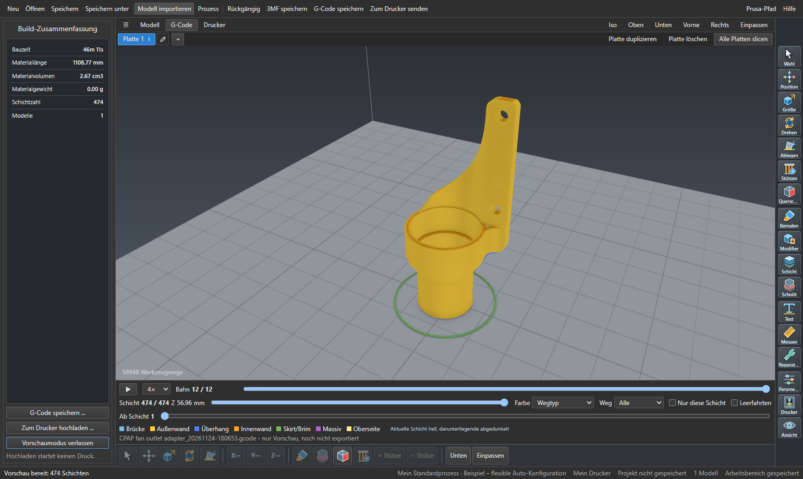

Die Vorschau zeigt Bauzeit, Materiallänge und Schichtzahl. Mit **G-Code speichern …** oder **Zum Drucker hochladen …** geht es weiter.

---

## Bei der Aufnahme gefundene Probleme

1. Beim Erststart ohne Basis sind der Düsendurchmesser leer und die Kategorie heißt noch „Qualität“ (Medium/Fine). Richtig wird beides erst nach Schritt 4.
2. In der Druckerverwaltung zeigt **„Als aktiven Drucker verwenden“** die Meldung „Slicing-Uebergabe noch nicht vorhanden“ und schaltet den Drucker nicht um. Umschalten klappt nur im Prozess.
3. Die Standard-Firmware des neutralen Druckers ist „RepRap (alt)“. Marlin 2 wäre der sinnvollere Standard.
4. Im Reiter Drucker überdeckt der Knopf „Weboberfläche öffnen“ die Überschrift „Bauraum“.
5. Im Basisprofil-Dialog stehen Umlaute als „ae“, z. B. „Waehle“ und „auswaehlen“. Außerdem werden die Prusa-Drucker zuerst gelistet, die Simpliy-Neutral-Einträge erst am Ende.
6. Die Build-Zusammenfassung zeigt ein Materialgewicht von 0,00 g, weil das neutrale Filament keine Dichte hat.
