# Simpliy Slicing – Illustrated first-time setup

[**Deutsch 🇩🇪**](README.md) · **English 🇬🇧**

Screenshots were captured on **November 24, 2026**, using `0.0.0-alpha.1` with an empty application data folder. The screenshots currently show **German UI labels**; we include these original names so you can follow each step.

## 1. First launch

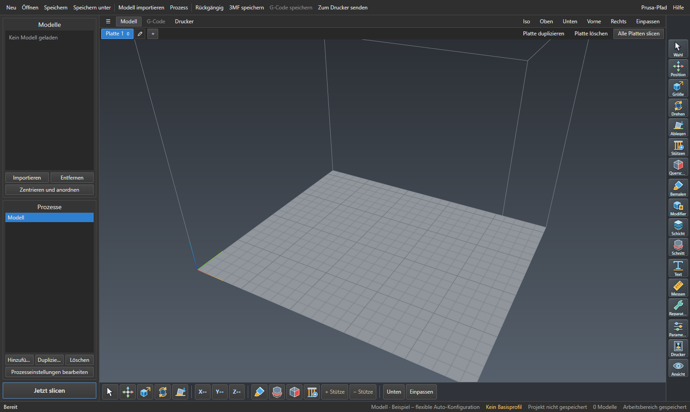

On first launch, Simpliy opens with an example process. At the bottom right, **No base profile** (`Kein Basisprofil`) indicates that slicing settings are incomplete.

> **Required:** You must choose both a printer and a filament/material in the process settings. Slicing is unavailable when either selection is missing.

## 2. Check the slicing engine (Help → Slicing engine)

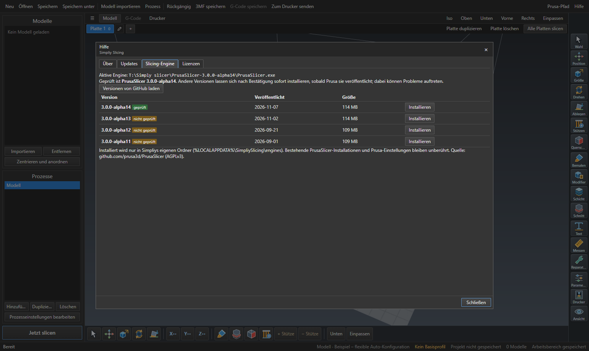

- Click **Help** (`Hilfe`) at the top right, then open **Slicing engine** (`Slicing-Engine`).
- **Active engine** (`Aktive Engine`) shows the detected PrusaSlicer path.
- If the engine is missing, choose **Load versions from GitHub** (`Versionen von GitHub laden`) and **Install** (`Installieren`) for **3.0.0-alpha14 (tested)** (`geprüft`).
- You may use another version after acknowledging its compatibility warning.
- The download is installed only into Simpliy's own folder; any existing PrusaSlicer installation is left untouched.

## 3. Open a process

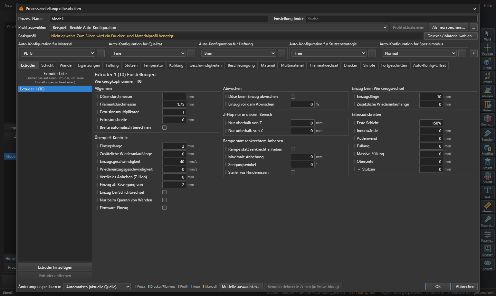

Click **Process** (`Prozess`) in the top toolbar. This is where you configure printer, material, layer height, and all other print settings.

## 4. Choose the base setup (once)

In the process dialog, click **Choose printer/material** (`Drucker / Material wählen…`) near the top right.

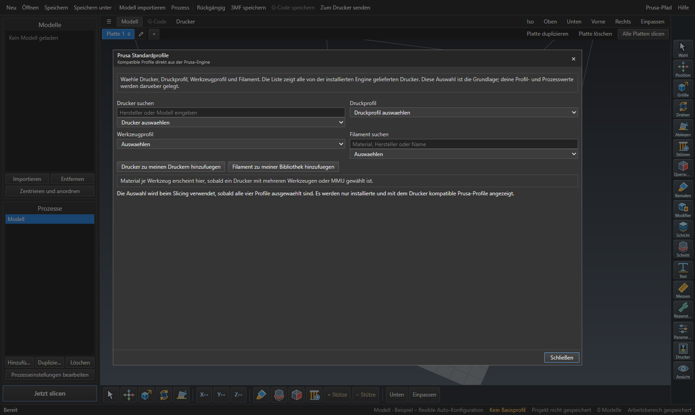

1. **Printer** (`Drucker`): choose `Simpliy Neutral (1 Tool)`. If you have multiple extruders, choose the matching `nT` variant.
2. **Print profile, tool profile, and filament:** choose `Simpliy` for each.

This gives the engine a neutral configuration; print values come from Simpliy.

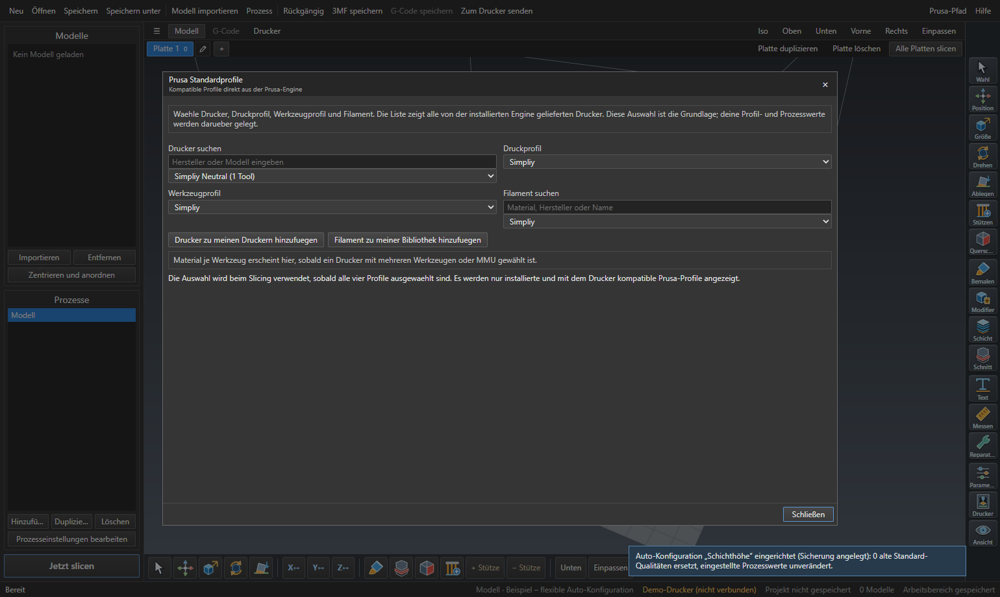

A message confirms that the layer-height auto-configuration was created. Finish with **Close** (`Schließen`).

## 5. Create your printer

In the process dialog, click **…** next to the printer field.

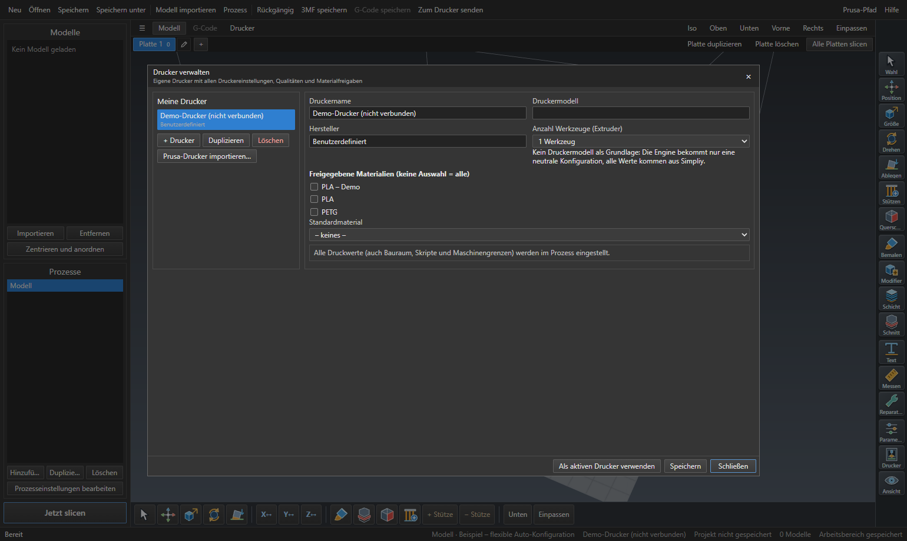

1. Click **+ Printer** (`+ Drucker`).
2. Enter a name under **Printer name** (`Druckername`), such as `My printer`.
3. Set **Number of tools** (`Anzahl Werkzeuge`).
4. Specify allowed materials and, if desired, a default material. A material must still be selected in the process.
5. Click **Save** (`Speichern`) and then **Close** (`Schließen`).

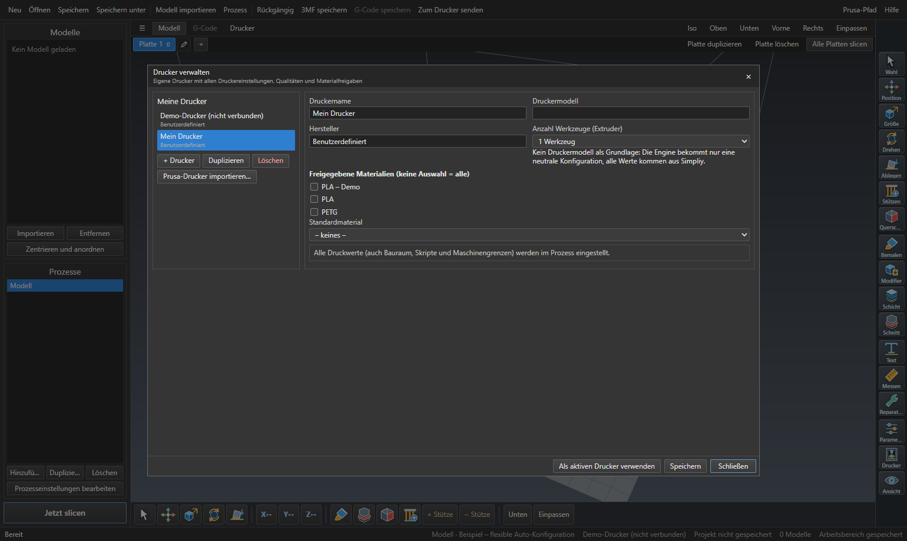

Select your new printer in the process dialog and choose the desired filament/material under **Material auto-configuration** (`Auto-Konfiguration für Material`). **Both selections are mandatory.**

## 6. Set printer parameters in the process

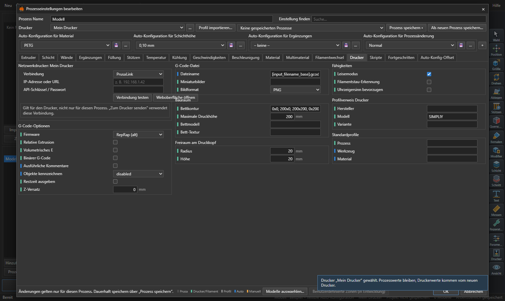

In the **Printer** (`Drucker`) tab:

- **Firmware:** choose your printer firmware, e.g. Marlin 2 or Klipper.
- **Bed shape** and **maximum print height:** enter your machine's build volume.
- **Network printer:** enter the printer's IP and API key if you want to upload G-code.

Then review the **Extruder**, **Temperature**, **Cooling**, **Speeds**, and **Scripts** tabs. In particular, verify nozzle and filament diameters, retraction, bed and chamber temperatures, fan settings, movement limits, and start/end G-code.

## 7. Save the process

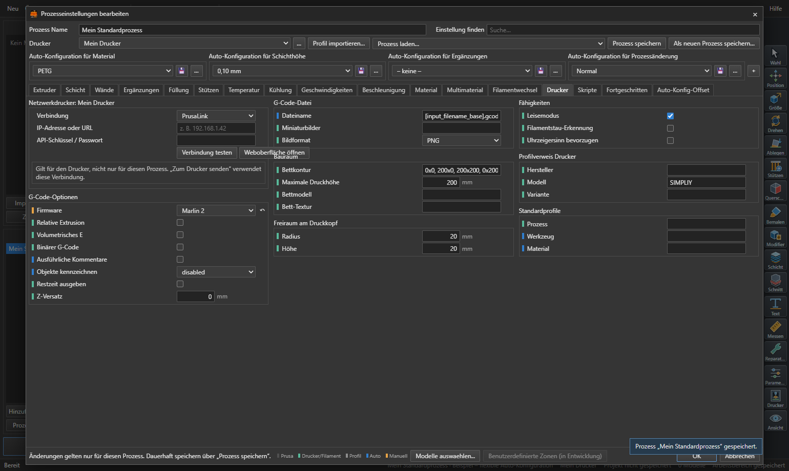

Click **Save as new process** (`Als neuen Prozess speichern…`) and give it a name such as `My standard process`. Later you can overwrite the saved version with **Save process** (`Prozess speichern`). Close the dialog with **OK**.

## 8. Load a model and slice

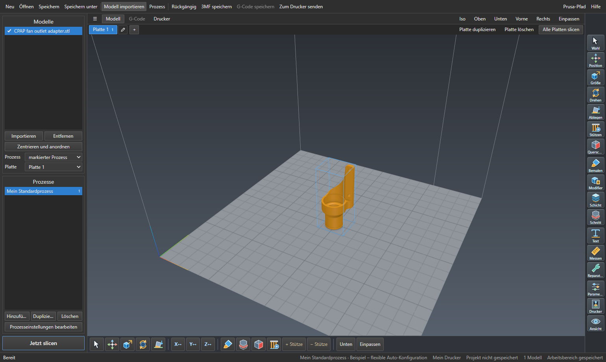

1. Click **Import model** (`Modell importieren`) and select an STL or 3MF file.
2. Verify that **a printer and a filament/material are selected**. Choose the layer height and any extra settings.
3. Click **Slice now** (`Jetzt slicen`) in the left panel.

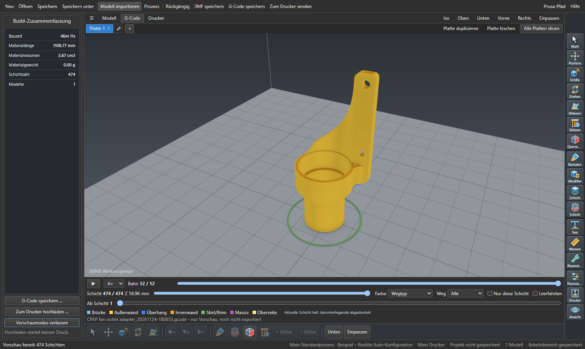

The preview shows estimated build time, material length, and number of layers. Continue with **Save G-code** (`G-Code speichern …`) or **Upload to printer** (`Zum Drucker hochladen …`).

---

## Issues recorded while capturing these screenshots

1. Before setting up a base profile, the nozzle diameter is empty and the quality category shows `Medium/Fine`. Both are initialized properly after step 4.
2. In printer management, **Use as active printer** (`Als aktiven Drucker verwenden`) does not change the active printer. Select it from the process dialog instead.
3. The neutral printer's default firmware is `RepRap (alt)`; choose the correct actual firmware for your printer.
4. In the printer tab, the **Open web interface** button overlaps the **Build volume** heading.
5. Some German words in the base-profile dialog are written without umlauts (`Waehle`, `auswaehlen`). Simpliy-neutral profiles appear below Prusa profiles.
6. Build summary may show a material weight of `0.00 g` when the neutral filament has no density value.
